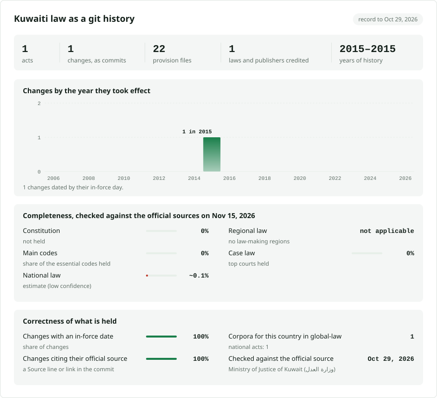

# Kuwait: law history in git

[العربية](README.md) · **English**

<picture>
<source media="(prefers-color-scheme: dark)" srcset="data/effort-dark.svg">

</picture>

The law of Kuwait as a git history: one file per provision, one commit per version on the day it took effect, and the act that made each change as the commit's author. `git blame` names the act behind every article; `git log` lists every change to an article; picking a date gives the text in force that day.

Part of [lexifina/global-law](https://github.com/lexifina/global-law), one git history for every country's law: this is Kuwait's national law, which global-law reads at `kuwait/national/acts/`.

**What is in it now:** one act, Law No. 63 of 2015 on combating information technology crimes, in one version: its 21 articles as issued, with no amendments recorded. The Constitution and the rest of Kuwaiti law are not here yet. [`law-63-2015/README.md`](law-63-2015/README.md) lists every article; [`REPRODUCE.md`](REPRODUCE.md) says how the files were made.

Each act is a folder with one file per article: `law-63-2015/art-001.md` is Article 1 of قانون رقم 63 لسنة 2015 في شأن مكافحة جرائم تقنية المعلومات (Law No. 63 of 2015 on combating information technology crimes).

The text is in Arabic, as the Ministry of Justice publishes it. An English translation is not part of this record.

## Questions as git commands

| Question | Command |
| --- | --- |
| Every change to Article 1 of Law 63/2015 | `git log -p --word-diff -- law-63-2015/art-001.md` |
| Which act wrote each line of Article 1? | `git blame law-63-2015/art-001.md` |
| Every version of Law 63/2015, with the day each took effect | `git log --format="%h %(trailers:key=In-force,valueonly,separator=) %an" -- law-63-2015 ":^law-63-2015/README.md"` |
| Article 1 as in force on 1 January 2026 | `python tools/on.py 2026-01-01 law-63-2015 art-001` |

**Outside git**, we also host this record publicly, for free:

- **[Ask Claude about Kuwaiti law](https://global-law.lexifina.com/v1/try_claude?country=kuwait)**: opens Claude with a first question ready.
- **[Ask ChatGPT](https://global-law.lexifina.com/v1/try_chatgpt?country=kuwait)**: the same question in ChatGPT.
- **[Search Kuwaiti law on our site](https://lexifina.com/law?country=kuwait&q=%D8%A7%D9%84%D8%B4%D8%A8%D9%83%D8%A9+%D8%A7%D9%84%D9%85%D8%B9%D9%84%D9%88%D9%85%D8%A7%D8%AA%D9%8A%D8%A9)**: a search for "الشبكة المعلوماتية" (the information network), with each provision's text and its versions, no account needed.
- **[Developer REST API](https://global-law.lexifina.com/v1/search_law?query=%D8%A7%D9%84%D8%B4%D8%A8%D9%83%D8%A9+%D8%A7%D9%84%D9%85%D8%B9%D9%84%D9%88%D9%85%D8%A7%D8%AA%D9%8A%D8%A9&jurisdiction=kuwait)**: the same search as JSON, with no key. See the [documentation here](https://lexifina.com/api/global-law).

Both assistants read the record through the free Global law connector (MCP, `https://global-law.lexifina.com/mcp`); the first time, the chat gives you the link that adds it. Ask in Arabic or in English.

**Host it yourself easily.** All it takes is git and Python, and the tools run on your machine:

```sh
git clone --depth 1 https://github.com/lexifina/global-law && cd global-law
python3 tools/countries.py add kuwait/national/acts
python3 tools/law.py show 2026-01-01 kuwait/national/acts/law-63-2015/art-001.md
```

Opened in Claude Code, Cursor, VS Code or Codex, the clone also starts a local MCP server with the same tools ([MCP.md](https://github.com/lexifina/global-law/blob/main/MCP.md)).

## Dates

Each commit is dated at noon, Asia/Kuwait, and carries its day in its `In-force:` trailer:

- by default a Kuwaiti law takes effect on its publication in Kuwait Al-Youm, the Official Gazette, unless it says otherwise;
- Law 63/2015 says otherwise: by its Article 21 it applies six months after its publication in the Official Gazette. The source gives no publication date, so its one version is dated 7 July 2015 (20 Ramadan 1436), the day the Amir issued it, as the oldest version available, not as the day it took effect. A date before 7 July 2015 gives no text.

That version is not credited to a law: it is credited to the publisher, the Ministry of Justice of Kuwait (وزارة العدل), as the "oldest version available" (`Kind: publisher`). The committer is Lexifina.

## How it is checked

- The text is the text layer of the Ministry's PDF, one paragraph or item per line. Digit runs the PDF stores in visual order were restored and checked against a rendering of the page, kashida was removed and spacing normalised; the wording was not changed. The PDF's sha256 is in `data/versions.json`.
- `tools/check_repo.py` reads every version back from git on the day it took effect and on the day before and compares it with the corpus, whose hash is in `data/corpus.sha256`; it also checks that every commit's trailers parse, that `main` has no merge commits and that no commit is dated in the future.
- `tools/build.py` writes the history from that one corpus file, and the same corpus gives the same commit hashes. [`REPRODUCE.md`](REPRODUCE.md) records that the checks were not yet run for this build and that no second build has been compared.
- [vulnerabilities/](vulnerabilities/README.en.md): possible drafting mistakes in this law, found by global-law's detectors and checked by hand. Not run yet.

## What it does not show

- **The Constitution and the rest of Kuwaiti law.** Only Law 63/2015 is here; the Ministry's PDF of the Constitution has an unreadable text layer, so it is not included.
- **Amendments.** Law 63/2015 is recorded as issued; amendments, if any, are not.
- **The preamble's recitals and the explanatory memorandum**, which are left out.

## Sources

| Source | Kind | Past versions | Notes |
| --- | --- | --- | --- |
| [Ministry of Justice of Kuwait](https://www.moj.gov.kw/AR/Pages/MojLaws.aspx) (وزارة العدل) | Official laws page, PDF | no, the law as issued | The PDF's text layer, read on 29 October 2026 |

## Licence

See [`LICENSE`](LICENSE). The Ministry states no licence; the text is official legislation, credited to the Ministry of Justice. Lexifina's history, commit messages, tables and tools are CC0 1.0.

No AI model wrote, translated or corrected legal text; the scripts were written by an AI model (see [`REPRODUCE.md`](REPRODUCE.md)).

## Visualisations

- [visualisations/](visualisations/README.en.md): charts drawn from this repository. Not drawn yet.

## More

From [lexifina/global-law](https://github.com/lexifina/global-law):

- [FEATURES.md](https://github.com/lexifina/global-law/blob/main/FEATURES.md): every feature, and what every corpus must support (`git blame`, `law.py`, the MCP tools)
- [FAQ.md](https://github.com/lexifina/global-law/blob/main/FAQ.md): questions and answers · [CONTRIBUTING.md](https://github.com/lexifina/global-law/blob/main/CONTRIBUTING.md): proposing changes · [MCP.md](https://github.com/lexifina/global-law/blob/main/MCP.md): the MCP server · [REPRODUCE.md](https://github.com/lexifina/global-law/blob/main/REPRODUCE.md): how it was built · [CHANGELOG.md](https://github.com/lexifina/global-law/blob/main/CHANGELOG.md)
- [FRESHNESS.md](https://github.com/lexifina/global-law/blob/main/FRESHNESS.md): how current each corpus is · [Monitoring](https://github.com/lexifina/global-law/tree/main/monitoring): whether updates are running · [WATCHING.md](https://github.com/lexifina/global-law/blob/main/WATCHING.md): how each official source is watched for changes
- [performance/](https://github.com/lexifina/global-law/tree/main/performance): how fast the tools are, measured
- [visualisations/](https://github.com/lexifina/global-law/tree/main/visualisations): charts and bridges across the world's law
- [Vulnerabilities](https://github.com/lexifina/global-law/tree/main/vulnerabilities): mistakes in legislation as published
