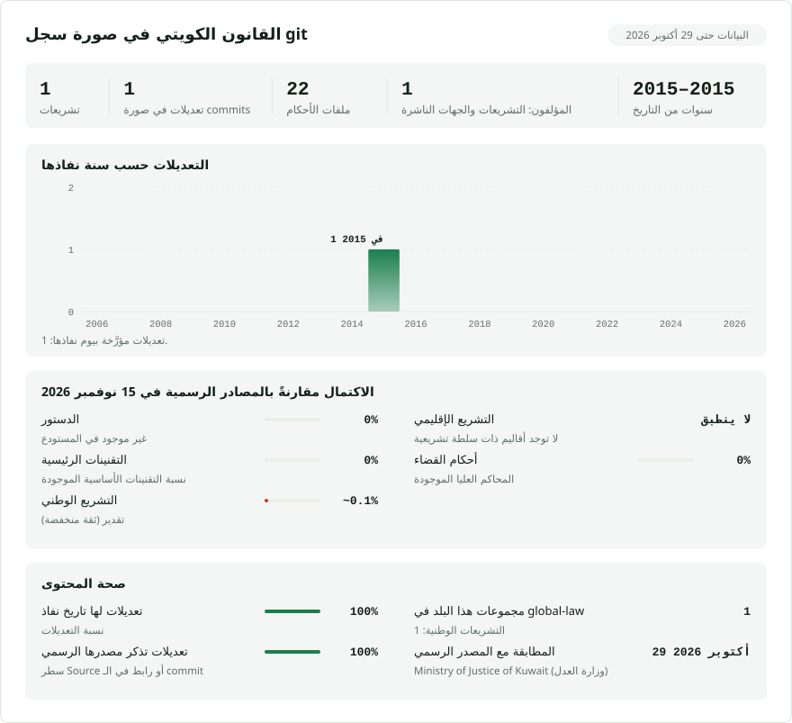

# الكويت: تاريخ القانون في git

**العربية** · [English](README.en.md)

<picture>
<source media="(prefers-color-scheme: dark)" srcset="data/ar/effort-dark.svg">

</picture>

القانون الكويتي في صورة سجل git: ملف لكل حكم، ولكل نسخة commit واحد في يوم نفاذها، والتشريع الذي أجرى كل تعديل هو مؤلف الـ commit. يبيّن `git blame` التشريع الذي يقف وراء كل مادة؛ ويسرد `git log` كل تعديل طرأ على مادة؛ واختيار تاريخ ما يعطي النص النافذ في ذلك اليوم.

جزء من [lexifina/global-law](https://github.com/lexifina/global-law)، وهو سجل git واحد لقانون كل بلد: هذا هو القانون الوطني الكويتي، الذي يقرؤه global-law في `kuwait/national/acts/`.

**المحتوى الحالي:** تشريع واحد، القانون رقم 63 لسنة 2015 في شأن مكافحة جرائم تقنية المعلومات، في نسخة واحدة: مواده الـ 21 كما صدرت، دون تسجيل أي تعديلات. ولا يوجد هنا حتى الآن الدستور ولا بقية القانون الكويتي. يسرد [`law-63-2015/README.md`](law-63-2015/README.md) كل مادة؛ ويبيّن [`REPRODUCE.md`](REPRODUCE.md) كيف أُعدّت الملفات.

كل تشريع مجلد، فيه ملف لكل مادة: `law-63-2015/art-001.md` هي المادة 1 من قانون رقم 63 لسنة 2015 في شأن مكافحة جرائم تقنية المعلومات.

النص باللغة العربية، كما تنشره وزارة العدل. والترجمة الإنجليزية ليست جزءًا من هذا السجل.

## الأسئلة في صورة أوامر git

| السؤال | الأمر |
| --- | --- |
| كل تعديل طرأ على المادة 1 من القانون 63/2015 | `git log -p --word-diff -- law-63-2015/art-001.md` |
| أي تشريع كتب كل سطر من المادة 1؟ | `git blame law-63-2015/art-001.md` |
| كل نسخ القانون 63/2015، مع يوم نفاذ كل منها | `git log --format="%h %(trailers:key=In-force,valueonly,separator=) %an" -- law-63-2015 ":^law-63-2015/README.md"` |
| المادة 1 كما كانت نافذة في 1 يناير 2026 | `python tools/on.py 2026-01-01 law-63-2015 art-001` |

**خارج git**، نستضيف هذا السجل أيضًا للعموم، مجانًا:

- **[اسأل Claude عن القانون الكويتي](https://global-law.lexifina.com/v1/try_claude?country=kuwait)**: يفتح Claude ومعه سؤال أول جاهز.
- **[اسأل ChatGPT](https://global-law.lexifina.com/v1/try_chatgpt?country=kuwait)**: السؤال نفسه في ChatGPT.
- **[ابحث في القانون الكويتي على موقعنا](https://lexifina.com/law?country=kuwait&q=%D8%A7%D9%84%D8%B4%D8%A8%D9%83%D8%A9+%D8%A7%D9%84%D9%85%D8%B9%D9%84%D9%88%D9%85%D8%A7%D8%AA%D9%8A%D8%A9)**: بحث عن "الشبكة المعلوماتية"، مع نص كل حكم ونسخه، دون الحاجة إلى حساب.
- **[واجهة REST API للمطوّرين](https://global-law.lexifina.com/v1/search_law?query=%D8%A7%D9%84%D8%B4%D8%A8%D9%83%D8%A9+%D8%A7%D9%84%D9%85%D8%B9%D9%84%D9%88%D9%85%D8%A7%D8%AA%D9%8A%D8%A9&jurisdiction=kuwait)**: البحث نفسه بصيغة JSON، دون مفتاح. انظر [التوثيق هنا](https://lexifina.com/api/global-law).

يقرأ المساعدان كلاهما السجل عبر موصِّل Global law المجاني (MCP، `https://global-law.lexifina.com/mcp`)؛ وفي المرة الأولى تعطيك المحادثة الرابط الذي يضيفه. اسأل بالعربية أو بالإنجليزية.

**استضفه بنفسك بسهولة.** كل ما يلزم هو git وPython، والأدوات تعمل على جهازك:

```sh
git clone --depth 1 https://github.com/lexifina/global-law && cd global-law
python3 tools/countries.py add kuwait/national/acts
python3 tools/law.py show 2026-01-01 kuwait/national/acts/law-63-2015/art-001.md
```

عند فتح النسخة المستنسخة في Claude Code أو Cursor أو VS Code أو Codex، تشغّل أيضًا خادم MCP محليًا بالأدوات نفسها ([MCP.md](https://github.com/lexifina/global-law/blob/main/MCP.md)).

## التواريخ

يحمل كل commit تاريخ الظهيرة، بتوقيت Asia/Kuwait، ويحمل يومه في تذييله (trailer) `In-force:`:

- يُعمل بالقانون الكويتي، كقاعدة عامة، من تاريخ نشره في الجريدة الرسمية "الكويت اليوم"، ما لم ينص على غير ذلك؛
- والقانون 63/2015 ينص على غير ذلك: فبموجب مادته 21 يُعمل به بعد ستة أشهر من تاريخ نشره في الجريدة الرسمية. ولا يعطي المصدر تاريخ النشر، لذا تحمل نسخته الوحيدة تاريخ 7 يوليو 2015 (20 رمضان 1436)، وهو يوم إصداره من الأمير، بوصفها أقدم نسخة متاحة، لا بوصفه يوم نفاذه. أي تاريخ قبل 7 يوليو 2015 لا يعطي نصًا.

لا تُنسب هذه النسخة إلى قانون: فهي منسوبة إلى الجهة الناشرة، وزارة العدل الكويتية، بوصفها "أقدم نسخة متاحة" (`Kind: publisher`). والمُودِع (committer) هو Lexifina.

## كيف يُتحقَّق منه

- النص هو الطبقة النصية لملف PDF الصادر عن الوزارة، بفقرة أو بند في كل سطر. أُعيدت سلاسل الأرقام التي يخزّنها ملف PDF بالترتيب المرئي إلى ترتيبها الصحيح وتُحقِّق منها بمقارنتها بصورة معروضة للصفحة، وأُزيلت الكشيدة (التطويل) ووُحِّدت المسافات؛ ولم تُغيَّر الصياغة. توجد بصمة sha256 لملف PDF في `data/versions.json`.
- يعيد `tools/check_repo.py` قراءة كل نسخة من git في يوم نفاذها وفي اليوم السابق له، ويقارنها بالمجموعة، التي توجد بصمتها (hash) في `data/corpus.sha256`؛ ويتحقق أيضًا من أن تذييلات كل commit قابلة للتحليل، وأن `main` خالٍ من commits الدمج، وأنه لا يوجد commit مؤرَّخ في المستقبل.
- يكتب `tools/build.py` السجل من ملف المجموعة الواحد هذا، والمجموعة نفسها تعطي بصمات الـ commits نفسها. ويسجّل [`REPRODUCE.md`](REPRODUCE.md) أن عمليات التحقق لم تُشغَّل بعد لهذا البناء وأنه لم تُقارَن به أي عملية بناء ثانية.

## ما لا يُظهره

- **الدستور وبقية القانون الكويتي.** لا يوجد هنا سوى القانون 63/2015؛ فالطبقة النصية في ملف PDF الخاص بالدستور الصادر عن الوزارة غير مقروءة، ولذلك لم يُدرج.
- **التعديلات.** القانون 63/2015 مسجَّل كما صدر؛ أما تعديلاته، إن وُجدت، فليست مسجَّلة.
- **حيثيات الديباجة والمذكرة الإيضاحية**، فهي مستبعدة.

## المصادر

| المصدر | النوع | النسخ السابقة | ملاحظات |
| --- | --- | --- | --- |
| [وزارة العدل الكويتية](https://www.moj.gov.kw/AR/Pages/MojLaws.aspx) | صفحة القوانين الرسمية، PDF | لا، القانون كما صدر | الطبقة النصية لملف PDF، قُرئت في 29 أكتوبر 2026 |

## الترخيص

انظر [`LICENSE`](LICENSE). لا تذكر الوزارة أي ترخيص؛ والنص تشريع رسمي، يُنسب إلى وزارة العدل. أما سجل Lexifina ورسائل الـ commits والجداول والأدوات فهي بموجب CC0 1.0.

لم يكتب أي نموذج ذكاء اصطناعي نصًا قانونيًا ولم يترجمه ولم يصححه؛ أما البرامج النصية (scripts) فكتبها نموذج ذكاء اصطناعي (انظر [`REPRODUCE.md`](REPRODUCE.md)).

هذا النص ترجمة للنسخة الإنجليزية ([README.en.md](README.en.md))؛ وعند الاختلاف تسود النسخة الإنجليزية.

## المزيد

من مستودع [lexifina/global-law](https://github.com/lexifina/global-law) (صفحات باللغة الإنجليزية):

- [FEATURES.md](https://github.com/lexifina/global-law/blob/main/FEATURES.md): جميع الميزات، وما يجب أن تدعمه كل مجموعة (`git blame`، `law.py`، أدوات MCP)
- [FAQ.md](https://github.com/lexifina/global-law/blob/main/FAQ.md): أسئلة وأجوبة · [CONTRIBUTING.md](https://github.com/lexifina/global-law/blob/main/CONTRIBUTING.md): اقتراح تغييرات · [MCP.md](https://github.com/lexifina/global-law/blob/main/MCP.md): خادم MCP · [REPRODUCE.md](https://github.com/lexifina/global-law/blob/main/REPRODUCE.md): طريقة البناء · [CHANGELOG.md](https://github.com/lexifina/global-law/blob/main/CHANGELOG.md)
- [FRESHNESS.md](https://github.com/lexifina/global-law/blob/main/FRESHNESS.md): مدى حداثة كل مجموعة · [المراقبة](https://github.com/lexifina/global-law/tree/main/monitoring): هل تعمل التحديثات · [WATCHING.md](https://github.com/lexifina/global-law/blob/main/WATCHING.md): كيف يُراقَب كل مصدر رسمي لرصد التغييرات
- [performance/](https://github.com/lexifina/global-law/tree/main/performance): سرعة الأدوات كما قيست
- [visualisations/](https://github.com/lexifina/global-law/tree/main/visualisations): رسوم بيانية وروابط عبر قوانين العالم
- [الثغرات](https://github.com/lexifina/global-law/tree/main/vulnerabilities): أخطاء في التشريعات كما نُشرت
